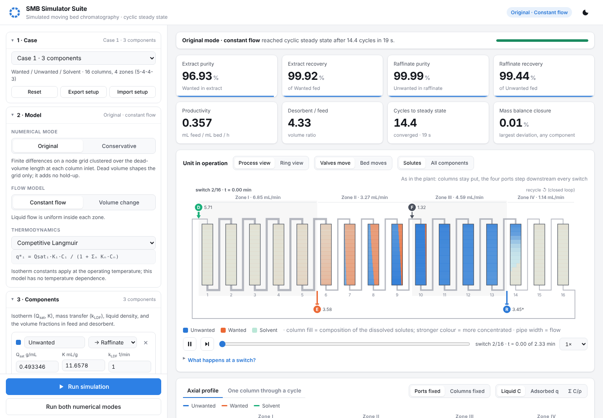
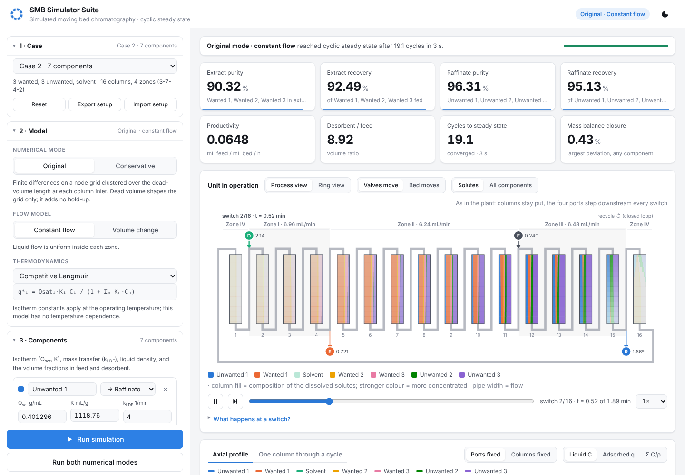

# SMB Simulator Suite

[](https://github.com/YC-Leo/SMB-simulator/actions/workflows/tests.yml)
[](LICENSE)
[](https://www.python.org/downloads/)

A browser-based simulator for **simulated moving bed (SMB) chromatography**, the continuous, counter-current adsorption process used to separate close-boiling or thermally sensitive mixtures. You can set up a separation, run it to cyclic steady state and explore the results in a local web app.

It is written in Python with NumPy only, so it runs on any laptop with no commercial solver or licence.





## Quick start

You need Python 3.8 or newer. NumPy is the only dependency.

| System | How to start |
|---|---|
| Windows | Double-click `launch_windows.bat` |
| macOS / Linux | Run `./launch_mac_linux.sh` |
| Any | Run `python -m pip install -r requirements.txt` once, then `python run_suite.py` |

The suite opens at <http://127.0.0.1:8050>. Everything runs locally: no internet, CDN or account needed.

Three test cases are built in. You can load any of them from **Case** at the top of the setup panel. **Case 1** (the default) has three components:

| Component | Leaves in | Role |
|---|---|---|
| **Wanted** | extract | product |
| **Unwanted** | raffinate | impurity |
| **Solvent** | — | desorbent |

**Case 2** has three **Wanted** components (extract), three **Unwanted** components (raffinate) and the **Solvent**, on 16 columns in a 3-7-4-2 layout. **Case 3** is the Case 2 system at a second operating point (other flows and switch time, volume-change flow).

Press **Run simulation** to see it. Case 1 takes under a minute in Original mode on a typical laptop, and Cases 2 and 3 about 10 seconds.

## What you can set up

The setup panel is grouped in the order an engineer would specify a unit.

1. **Case**: load a test case; reset, export or import a setup as JSON.
2. **Model**: numerical mode (see below), flow model and isotherm.
   - The competitive Langmuir isotherm is q\*ᵢ = Q<sub>sat,i</sub>·Kᵢ·Cᵢ / (1 + Σ Kₙ·Cₙ).
   - Its constants apply at the operating temperature. The model has no temperature dependence, so there is no temperature input.
3. **Components** (2–10), each with:
   - name and target outlet
   - Q<sub>sat</sub> and K
   - LDF mass-transfer coefficient k
   - liquid density
   - volume fractions in feed and desorbent
4. **Columns & packing**:
   - **Column size** as internal radius and packed length. The area, column volume and pore volume are shown.
   - **Porosity** as either a total porosity, or bed void fraction ε<sub>b</sub> plus particle porosity ε<sub>p</sub>, combined as ε<sub>t</sub> = ε<sub>b</sub> + (1 − ε<sub>b</sub>)·ε<sub>p</sub>. Case 2 uses this form.
   - **Axial dispersion** as either the column Péclet number, or derived from particle size: Pe = Pe<sub>p</sub>·L/d<sub>p</sub>, with Pe<sub>p</sub> ≈ 0.5 for packed beds. 100 µm particles in a 20 cm column give Pe = 1000.
     - The dispersion coefficient D<sub>ax</sub> = u·L/Pe and the velocity u = Q/(A·ε<sub>t</sub>) are shown for every zone. This is where porosity and dispersion interact.
   - **Extra-column (dead) volume** as a tube length per column.
5. **Process layout & operation**:
   - **Zones:** 2–6 zones with up to **16 columns** in total.
   - **Ports:** each zone starts at a port, which can be desorbent in, feed in, extract out or raffinate out.
   - **Recycle:** closed loop (recycle to zone I) or open loop (no recycle).
   - **Balance outlet:** one outlet's flow is computed so that the liquid balance closes; you specify the others.
   - **Quick layouts:** classic 4-zone, 3-zone open loop, and 5-zone with two extracts.
   - **Live panel:** flow, m-value, velocity and D<sub>ax</sub> per zone, plus the balance flow, desorbent-to-feed ratio and cycle time.
6. **Numerics**: grid, steady-state tolerance, cycle limit, convergence acceleration.

Setups saved by the first version (fixed four zones, cross-section and total porosity) still import.

## What you get

The results page uses toggles and tabs so that each view stays readable.

- **KPIs**: extract and raffinate purity and recovery on a desorbent-free basis, productivity, desorbent-to-feed ratio, cycles to steady state and mass-balance closure. Each tile shows the change from the previous run.
- **Unit in operation**, a process view of the actual unit:
  - Every column is drawn with the liquid composition along its length, so you can see the components separate into bands.
  - Inlets enter from above and outlets leave below; pipe width is proportional to flow.
  - **Valves move** shows the plant: columns stay put and the ports step downstream at every switch.
  - **Bed moves** shows the equivalent moving bed: the ports stay put and the columns slide one position upstream.
  - **Fill:** *Solutes* (colour strength = concentration) or *All components*.
  - **Ring view:** the same unit drawn as a ring.
  - Hover over a column to see its zone, inlet flow and composition. ⏭ jumps to the next switch.
- **Profiles** (tabs):
  - The axial profile, shown with *Ports fixed* or *Columns fixed* (the plant view). It can show liquid C, adsorbed q or Σ C/ρ.
  - One column's outlet followed through a full cycle, as the ports move past it.
- **Products** (tabs):
  - Outlet concentration histories, with a toggle per outlet port.
  - Where each component goes, and the product compositions.
  - A performance table by component and by outlet stream.
- **Convergence** (tabs): purity and recovery cycle by cycle, and the steady-state residual.
- **Run history** for comparing layouts, settings and numerical modes. Results can be downloaded as CSV.

## What a switch is, and how it is simulated

An SMB unit is a ring of fixed columns with ports. The classic unit has four:

- **D**: desorbent in
- **E**: extract out
- **F**: feed in
- **R**: raffinate out

Every switch time t\*, all ports move one column downstream, in the direction of the liquid. Nothing inside the columns moves at the switch; only the valves change. Seen from the ports, the packing has moved one column upstream, which is how SMB imitates a true counter-current moving bed. After one switch per column (one cycle), every port is back where it started.

The simulator works in the frame of the ports:

1. Integrate all columns for one switching period with the ports fixed.
2. Re-index the columns so that the column that was second after the desorbent port becomes the first. The first column becomes the last column of the last zone. In equations: `C_end[j] = C_0[j-1]`.
3. Repeat from a column full of desorbent until the state at the start of a switch stops changing (cyclic steady state).

The *Columns fixed* view and the full-cycle chart convert that back into the plant view: after *s* switches, physical column *p* is at port-frame position (*p* − *s*) mod *N*.

## The two numerical modes

| Mode | What it does |
|---|---|
| **Original** | Finite differences on a node grid. Grid points are clustered over the dead-volume length at each column inlet, with central finite differences, an inlet node from the mixing balance and flow from the source/drain balance. The dead-volume length shapes the grid only; it adds no hold-up. |
| **Conservative** | A finite-volume formulation in flux form: MUSCL / van Leer reconstruction with a Danckwerts inlet. The dead volume is modelled as an open tube section (no adsorbent) at the inlet of every column, so it adds real extra-column hold-up. |

**Run both modes** runs the same setup in each mode and lists both in the run history.

The modes treat dead volume differently, so their results diverge as the dead-volume length grows. With the default 2 cm, the conservative mode adds about 1.4 mL of open volume per column, roughly 22% of the column's pore volume. That lowers the effective zone II m-value to about zero, which shows up as a much lower extract purity. Set the dead-volume length to 0 to compare the two modes on the bed alone.

Both flow models are available in either mode:

- **Constant flow**: the flow is uniform inside each zone.
- **Volume change**: the liquid flow varies along the bed as components of different density adsorb and desorb.

## Validation

`python validation/validate_cases.py` runs the three test cases in Original mode and compares them with their benchmark values.

**Case 1** (3 components)

| Original mode | Extract purity | Extract recovery | Raffinate purity | Raffinate recovery |
|---|---|---|---|---|
| Constant flow, this code | 96.93 | 99.92 | 99.99 | 99.44 |
| Constant flow, benchmark | 96.96 | 99.92 | 99.99 | 99.46 |
| Volume change, this code | 98.62 | 99.10 | 99.97 | 100.09 |
| Volume change, benchmark | 98.63 | 99.08 | 99.96 | 100.10 |

**Cases 2 and 3** (7 components, 3-7-4-2). The table shows extract recovery and desorbent-free extract purity, in %, as simulator / benchmark.

| Component | Case 2, constant flow | Case 2, volume change | Case 3 (volume change) |
|---|---|---|---|
| Wanted 1 | 92.14 / 92.03 · 56.58 / 56.49 | 90.74 / 91.32 · 56.98 / 57.11 | 75.42 / 75.46 · 54.87 / 54.80 |
| Wanted 2 | 87.72 / 87.80 · 8.44 / 8.45 | 85.97 / 86.68 · 8.46 / 8.50 | 67.04 / 67.09 · 7.65 / 7.64 |
| Wanted 3 | 95.03 / 95.05 · 25.30 / 25.29 | 94.79 / 94.77 · 25.80 / 25.69 | 87.50 / 87.55 · 27.60 / 27.56 |
| Unwanted 1 | 1.27 / 1.23 · 0.69 / 0.67 | 1.09 / 1.03 · 0.61 / 0.57 | 1.34 / 1.32 · 0.87 / 0.85 |
| Unwanted 2 | 0.78 / 0.75 · 0.38 / 0.37 | 0.66 / 0.63 · 0.33 / 0.32 | 0.87 / 0.84 · 0.51 / 0.49 |
| Unwanted 3 | 8.74 / 8.86 · 8.61 / 8.72 | 7.76 / 7.79 · 7.82 / 7.81 | 7.29 / 7.43 · 8.51 / 8.66 |

Every value in all three runs (both outlets) is within 0.71 percentage points of the benchmark. The Case 2 end-of-switch axial profile (7 components × 224 nodes) matches the benchmark profile to within 0.0023 g/mL, against a peak concentration of 0.645 g/mL. The benchmark profile is stored in `validation/reference/`.

A three times smaller time step changes nothing in the results. The small remaining differences come from time discretisation: the benchmark values were computed with orthogonal collocation in time (2 finite elements × 3 Radau points per switch), while this code integrates in time to convergence.

## Sensitivity study

`python validation/sensitivity_study.py` changes one input at a time on Case 2. It checks each response against what triangle theory and the usual non-ideal effects predict, and writes the table to `validation/sensitivity_results.md`. All 11 checks agree.

| Change | Extract purity | Extract recovery | Raffinate purity | Raffinate recovery | Why |
|---|---|---|---|---|---|
| Base case | 90.32 | 92.49 | 96.31 | 95.13 | m₂ = 0.549, m₃ = 0.648 |
| Péclet 1000 → 250 | −1.55 | −1.66 | −0.59 | −0.60 | more dispersion broadens the fronts |
| Particles 100 → 300 µm | −1.07 | −1.27 | −0.39 | −0.38 | Pe = Pe<sub>p</sub>·L/d<sub>p</sub> falls 3× |
| Mass transfer k 4 → 2 /min | −13.5 | −14.7 | −7.0 | −6.5 | slower uptake smears the fronts |
| Column radius +1% (same flows) | −34.6 | +3.5 | +0.4 | −32.5 | every m falls, so unwanted material is held back into the extract |
| Bed void 0.387 → 0.395 | −2.6 | +0.7 | +0.4 | −1.5 | less adsorbent, so every m falls slightly |
| Switch time −2% | −35.3 | +3.2 | +0.2 | −33.3 | every m falls |
| Switch time +2% | +9.0 | −27.1 | −10.3 | +5.0 | every m rises, so wanted material is pushed to the raffinate |
| Columns 3-7-4-2 → 3-6-5-2 | −1.4 | +1.8 | +1.1 | −0.2 | longer zone III, shorter zone II |
| Half as many, twice as long columns | −0.1 | −1.3 | −0.5 | 0.0 | coarser port movement |
| Volume change instead of constant flow | +0.9 | −1.1 | −0.3 | +0.7 | density-driven flow changes |

The largest effects come from changes of only 1–2% in switch time or column volume. This case operates in a narrow window (m₂ = 0.55 to m₃ = 0.65), so such changes move the operating point across it. Narrow windows like this are the robustness problem known for SMB separations of close-retention mixtures, and the reason such units need tight control of flow and switch time.

A note on how these checks were written: the first draft predicted the wrong direction for the column-volume, void-fraction and switch-time cases. Working the m-values out showed that the model, not the prediction, was right. The predictions in the script are the corrected, theory-based ones.

## Model

For each column and component *i*:

- **Liquid**: ∂C/∂t + 1/(Aε) ∂(F C)/∂x = D ∂²C/∂x² − (1−ε)/ε · ∂q/∂t
- **Solid**: ∂q/∂t = k (q\* − q)
- **Flow**: constant, or ∂F/∂x = −A(1−ε) Σ (∂qᵢ/∂t)/ρᵢ

Ports are switched explicitly, one column at a time, until the state change per switch falls below the tolerance. A cycle-to-cycle extrapolation shortens the approach to cyclic steady state; you can turn it off under Numerics. Time integration is SSP-RK3.

## Project layout

```
smbsim/              simulation engine (NumPy only)
  config.py          inputs, layout (zones and ports), derived quantities, validation, test cases
  isotherms.py       isotherm registry
  solver.py          both numerical modes, port switching, metrics
webapp/              local web server (Python standard library) and UI
  static/            HTML/CSS/JS with hand-written SVG charts, no external libraries
run_suite.py         launcher
validation/          test cases against benchmark values, physics checks, sensitivity study
tests/               quick sanity tests
```

The engine can also be used from Python:

```python
from smbsim import case_1, run
res = run(case_1(scheme="original", flow_model="volume_change"))
print(res["metrics"]["extract_purity"])
```

### Adding a thermodynamic model

1. Write a function `f(C, p)` that returns q\* for the concentration array `C` (components × columns × points) and the parameter dict `p`.
2. Register it in `ISOTHERMS` in `smbsim/isotherms.py` with a label, its equation and its parameter names.

It then appears in the web app's isotherm list.

## Contributing

Please read [CONTRIBUTING.md](CONTRIBUTING.md) for setup instructions, test and validation commands, and pull request expectations.

## License

This project is licensed under the MIT License. See [LICENSE](LICENSE).
